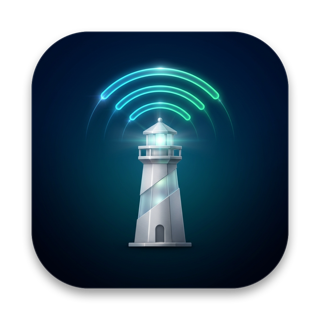

<p align="center">
  
</p>

<h1 align="center">AirPhare</h1>

<p align="center">
  <strong>A lighthouse for your home Wi-Fi — native macOS menu bar app for Wi-Fi control, silent real-time diagnostics, and long-term CSV logging.</strong>
</p>

<p align="center">
  
  
  
  
  
</p>

---

## Why AirPhare?

Everyone knows the feeling: **your internet suddenly feels sluggish** — video calls stutter, web pages pause for a beat before loading, or downloads crawl at a fraction of your plan. Standard speed tests only tell you *that* something is slow, almost never **why**:

* Did your router silently drop from a clean DFS 5 GHz channel (e.g., Channel 100) back onto congested Channel 36 because of weather radar?
* Did macOS quietly fall back onto your slow **2.4 GHz** band?
* Did a nightly PPPoE reconnect leave a **stale, non-deprecated IPv6 prefix** stuck on `en0`, causing **100% IPv6 packet loss** and a router routing loop until Happy Eyeballs falls back to IPv4?
* Is the jitter happening on **Hop 1 (your Wi-Fi / router)** — or is your **ISP line** acting up?
* Is your local DNS stack (**Pi-hole**, **Tailscale MagicDNS**, or router DNS) adding latency spikes?

Worse yet, many network monitors hammer your Wi-Fi radio with constant background RF scans or automated speed tests — actively causing the exact **ping spikes and bufferbloat** they claim to monitor.

**AirPhare takes a different approach:**
* **Whisper-quiet in the background:** Every 5 minutes (configurable), AirPhare runs lightweight, strictly sequential checks using `CoreWLAN`, tiny idle pings, IPv6 prefix inspection, and a single DNS probe — **zero bandwidth load, zero active scan jitter**.
* **Only taps you on the shoulder when something actually breaks:** Native macOS notifications (with a 30-minute cooldown per alert category so it never spams) paired with **1-click fixes** (such as a 3-second Wi-Fi reset to clear stale IPv6 prefixes, an on-demand channel scan, or opening your router admin page).
* **Replaces the built-in macOS Wi-Fi menu bar widget:** Clean Wi-Fi power toggle, proximity-matched known networks (only networks actually in range), expandable nearby networks with inline password entry, and a direct shortcut to macOS Wi-Fi Settings.
* **Real-world impact:** Moving off a crowded 5 GHz Channel 36 onto Channel 100 (ETSI 1,000 mW power budget) and clearing a stale IPv6 prefix produced these exact sequential `networkQuality` results:

| Metric | Before (Ch 36 + Stale IPv6) | After (Ch 100 + IPv6 Fix) | Delta |
|---|---:|---:|---:|
| **Downlink** (`networkQuality`) | `59.8 Mbps` | **`199.7 Mbps`** | **3.3× faster** |
| **Uplink** (`networkQuality`) | `75.7 Mbps` | **`203.1 Mbps`** | **2.7× faster** |
| **Bufferbloat (Loaded Latency)** | `244 ms` (`245 RPM`) | **`92 ms` (`652 RPM`)** | **−62% latency under load** |
| **IPv6 Connectivity** | `100% packet loss` | **`0% packet loss`** | **Fully fixed** |

---

## Key Features

### 1. Native macOS Menu Bar Wi-Fi Replacement
* **Compact icon-only menu bar footprint** (automatically reflects status via `wifi`, `wifi.exclamationmark`, and `wifi.slash`; optional inline metrics can be toggled in Settings).
* **Built with AppKit `NSStatusItem` + `NSPopover`** — docks flush beneath the menu bar icon with native arrow alignment and dynamic sizing (avoiding SwiftUI `MenuBarExtra` layout offsets).
* **Full daily control:** Wi-Fi on/off switch, **Known Networks** filtered by actual RF proximity via `CWInterface.cachedScanResults()`, expandable **Other Networks** (on-demand scan + inline password prompt), and **Wi-Fi Settings…**.
* **Multilingual UI (6 languages):** Automatically adapts to your macOS system language — or switch live in Settings between **English, Deutsch, Italiano, Français, Español, and Nederlands**.

### 2. Silent Background Watchdog (Zero Load)
* **Wi-Fi Link Telemetry (`CoreWLAN`):** Band (2.4 / 5 / 6 GHz), channel, channel width, PHY mode, RSSI / Noise / SNR, and transmit rate.
* **DFS Channel Drift & 2.4 GHz Fallback Alerts:** Immediately notices if your router jumps away from your preferred 5 GHz channel or your Mac drops to 2.4 GHz.
* **Stale IPv6 Prefix & Routing-Loop Detector:** Parses `ifconfig` flags to catch multiple active non-deprecated global IPv6 prefixes and detects IPv6 blackholes (100% IPv6 loss while IPv4 works) — with a **1-click Wi-Fi Reset**.
* **Wi-Fi vs. ISP Isolation:** Separates Hop-1 gateway jitter from upstream ISP latency (`1.1.1.1`) and surfaces a clear status badge.
* **DNS Latency Check:** Benchmarks uncached lookups on your active system resolver (e.g., Pi-hole / Tailscale MagicDNS) directly against `1.1.1.1`.

### 3. On-Demand Deep Diagnostics (Call-Safe)
* **ETSI/DE-Aware Channel Advisor:** Scans nearby APs on demand, evaluates 5 GHz 80 MHz blocks (`36`, `52`, `100`, `116`) accounting for 160 MHz neighbor overlap, ETSI 1,000 mW power rules (Ch 100+), and weather-radar DFS penalties, and recommends only non-overlapping 2.4 GHz channels (`1`, `6`, `11` at 20 MHz).
* **Sequential Full Benchmark:** Runs strictly in order so load never pollutes idle metrics: *1) Wi-Fi + RF Scan → 2) Idle Latency (Gateway, IPv4, IPv6) → 3) DNS → 4) Apple's built-in `networkQuality -c` (Downlink, Uplink, Idle Latency, Loaded RPM, and ECN/L4S)*.

### 4. Automatic Long-Term CSV Logging
* Every background check, benchmark, RF scan, and Wi-Fi reset is automatically appended to:
  ```text
  ~/Library/Application Support/AirPhare/airphare-log.csv
  ```
* Includes automatic log rotation at 10 MB, persistent sparkline history across restarts (last 48 samples), and a **`Log (N)`** button to reveal the CSV directly in Finder for multi-day analysis in Numbers, Excel, or Python.

---

## Download & Install

### Pre-built Release (Signed & Notarized DMG)
Download the latest universal `.dmg` (`arm64` + `x86_64`) from [**GitHub Releases**](https://github.com/ralksta/airphare/releases/latest), open it, and drag **AirPhare.app** into **Applications**.

### Build from Source

Requirements: **macOS 15+** and **Xcode / Swift 6 toolchain**. Zero third-party dependencies, no cloud services, 100% local.

```bash
# Clone the repository
git clone https://github.com/ralksta/airphare.git
cd airphare

# Run unit tests (Swift Testing)
swift test

# Build release app bundle, install to /Applications, and launch
./scripts/build-app.sh --install --run

# Build a Developer ID signed & Apple-notarized universal DMG (optional --publish for GitHub Releases)
./scripts/release-dmg.sh --publish
```

### Recommended First-Run Setup
1. **Allow Notifications** so AirPhare can alert you on DFS channel drift, IPv6 loops, or sudden Wi-Fi/ISP issues.
2. **Grant Location Services (optional, 1-click inside the popover):** On modern macOS, Apple redacts Wi-Fi SSIDs from CoreWLAN without Location permission. Granting it enables active SSID highlighting, nearby network names, and RF proximity filtering for Known Networks. Location data never leaves your Mac.
3. **Launch at Login:** Open the gear icon → enable **"Launch at Login"** (`SMAppService`).
4. **Hide Apple's built-in Wi-Fi icon (optional):** *System Settings → Control Center → Wi-Fi → Don't Show in Menu Bar*. *(Apple's Instant Hotspot remains 1 click away inside Control Center.)*

---

## Project Structure

```text
airphare/
├── Package.swift                      # Swift 6 package (zero external dependencies)
├── Resources/
│   ├── Info.plist                     # LSUIElement = true, AppIcon, Location usage string
│   ├── AppIcon.icns                   # Multi-resolution macOS app icon
│   └── AppIcon-1024.png
├── Sources/
│   ├── AirPhareCore/                 # Pure diagnostics & analysis library (unit-tested)
│   │   ├── Models.swift               # Sendable value types & monitor settings
│   │   ├── Parsers.swift              # ping/ping6, ifconfig IPv6, dig, networkQuality JSON
│   │   ├── ChannelAnalyzer.swift      # 5 GHz & 2.4 GHz channel congestion scoring
│   │   ├── HealthEvaluator.swift      # Rule engine for status & actionable advice
│   │   ├── HistoryLogger.swift        # Actor-isolated CSV logger & history loader
│   │   ├── DiagnosticsService.swift   # CoreWLAN + sequential network probes
│   │   └── ShellRunner.swift          # Async process runner with timeout
│   └── AirPhare/                     # Native macOS app (AppKit + SwiftUI)
│       ├── AirPhareApp.swift         # NSStatusItem + NSPopover AppDelegate
│       ├── MonitorViewModel.swift     # @Observable @MainActor state, timer, NWPathMonitor
│       ├── MenuBarView.swift          # Wi-Fi picker + live diagnostic cards
│       ├── SettingsView.swift         # Thresholds, router URL & Launch at Login
│       ├── SparklineView.swift        # Native Canvas history sparklines
│       └── AlertNotificationManager.swift
├── Tests/AirPhareCoreTests/          # Swift Testing suite
└── scripts/build-app.sh               # Release build, .app bundler & ad-hoc codesign
```

---

## Privacy

AirPhare collects **zero telemetry**. All diagnostics, settings, and CSV logs stay strictly on your Mac. Network probes only contact your local gateway, your configured DNS resolver, Cloudflare (`1.1.1.1` / `2606:4700:4700::1111`), a random `wikipedia.org` subdomain for uncached DNS timing, and — only when you explicitly click *Full Benchmark* — Apple's built-in `networkQuality` endpoint.

## License

[MIT](LICENSE)
